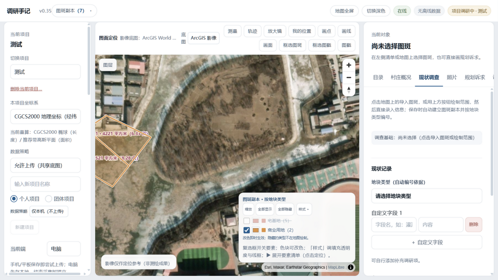
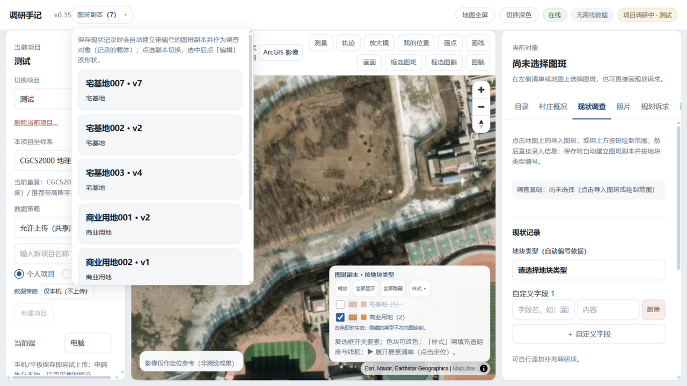
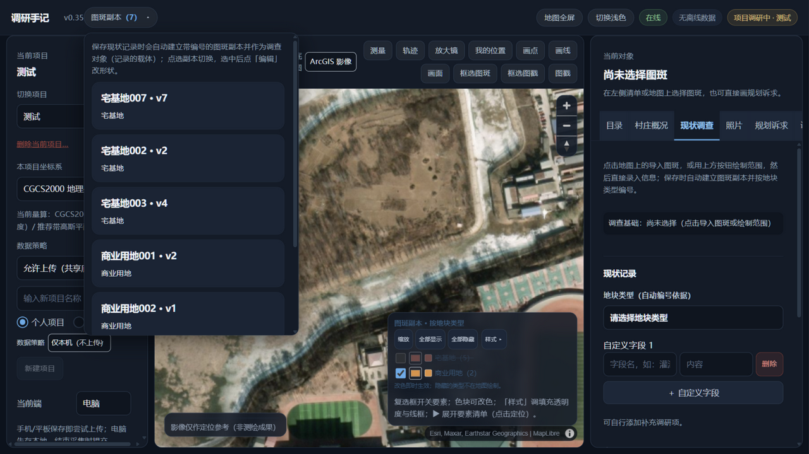
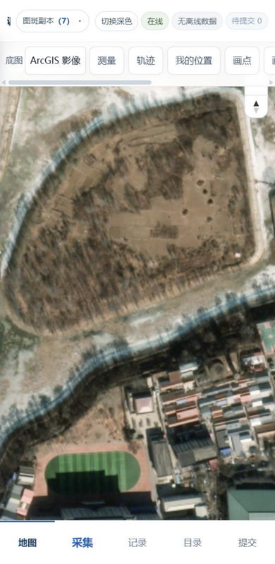

# 调研手记 · 规划调研智能工作台

面向村庄规划现场调研的一体化工作台：**一张图上完成底图核对、图斑录入、现状调查、规划诉求记录与成果输出**，为规划师外业调研量身打造。

> **产品展示页（在线看）**：<https://liulei97.github.io/diaoyan-shouji/>
>
> 本仓库为产品展示页，源码暂未开放。欢迎交流调研方法与产品思路；未经授权，请勿复制、商用或二次分发本项目的任何界面素材与文档内容。

## 它解决什么问题

村庄规划调研常年面对"纸图 + 相机 + Excel"的碎片化流程：现场勾图靠手绘、记录靠纸笔、回办公室再数字化。调研手记把这条链路搬进一块屏幕——**在现场就把图斑、记录、照片、诉求全部数字化**，回到办公室直接出成果。

## 核心能力

- **在线底图 + 多源数据叠加**：ArcGIS 影像/天地图底图，支持上传 SHP、File GDB、CAD（DWG/DXF）成果图层，坐标系自动识别（含 CGCS2000 各带、随图 .prj）。
- **图斑副本（调查对象）**：点选或勾选录入图斑，自动按地块类型编号建档；顶点编辑、分割/合并/打断/延伸、简化/外扩/内缩一应俱全，转性地块可重新编号。
- **现状调查动态表单**：按地块类型下发专项字段（宅基地/耕地/商工仓储…），支持自定义字段；多人协作带录入人归属与版本留痕。
- **图斑档案一键预览**：点选图斑弹出档案浮窗——基本信息、全部调研内容明细、挂接的规划诉求，一窗阅览。
- **规划诉求管理**：诉求可挂原图斑/图斑副本/设施图戳/自绘范围，支持编辑与删除，地图橙色虚线直观呈现。
- **设施图戳**：16 大类现状/规划两套标准图戳，点图即录入调查，自动联动地块类型与规划诉求。
- **离线优先采集**：现场断网照常采集，数据存本机，联网自动入库；手机/平板端有专属交互（底部导航、抽屉表单、触屏增强）。
- **多用户与权限**：个人/团体项目、账号体系、行级数据归属、共享编辑开关。
- **成果输出**：调研图带图戳导出、Excel 台账、SHP/DXF 成果回传。

## 近期更新（v1.1 – v1.3）

- **分地类成套出图**：选一种地块类型，一键出「调查图 + 台账表」——图上标号与表内编号一一对应，没查到的地块在台账里如实标"待调查"。
- **调研报告 Word**：七章成册自动生成，页内注明数据口径。
- **离线底图包**：出发前框选范围预取影像瓦片，现场断网自动切换离线底图。
- **现场顺手件**：语音记事挂调查记录、地图手绘涂鸦标注、照片批量导入后按拍摄位置与时间自动建议挂到哪块地。
- **AI 辅助（可选，默认不出网）**：村情一页摘要只汇总已录入数据、缺失如实说明、不做政策结论；照片智能归档为可选视觉模型——只上传缩略图、人工确认后才写入。
- **调研进度看板**：调查回收率、证据状态分布、成员工作量，一屏看清项目进度。

## 界面速览

| | |
|---|---|
|  |  |
|  |  |

## 技术形态

单机/内网部署（Windows 一键启动），另有免安装桌面版。Vue 3 + MapLibre GL + FastAPI + SQLite，支持局域网多端访问与 HTTPS；调查数据本机优先，照片与轨迹不出网。

## 版权与使用

© 2026 保留所有权利。本项目源码与设计版权归作者所有：**仅供学习交流参考，未经授权不得复制、修改、商用或二次分发**。如需试用、合作或定制，欢迎提 Issue 或与作者联系。
