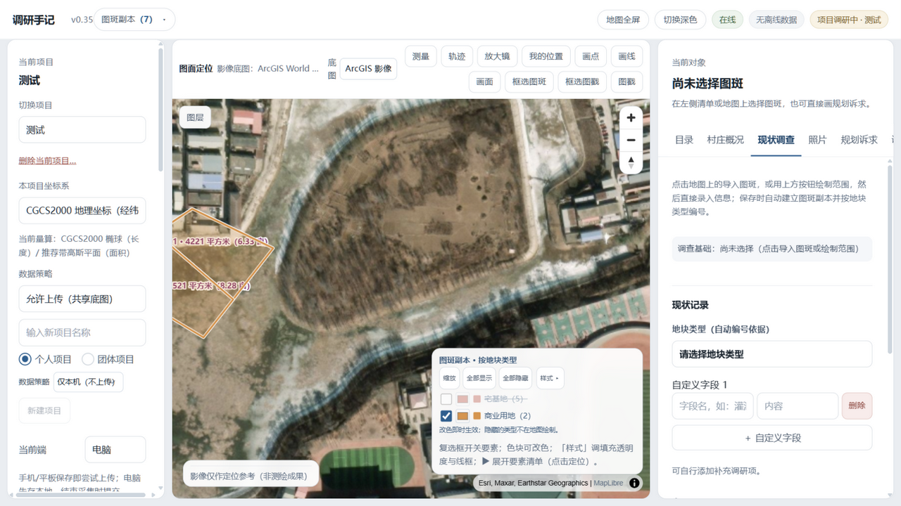
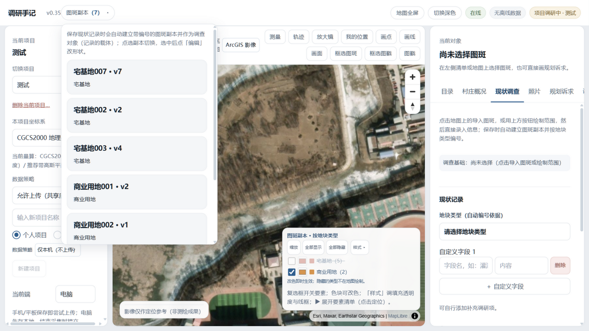
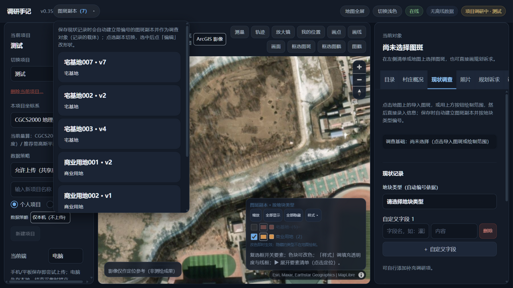
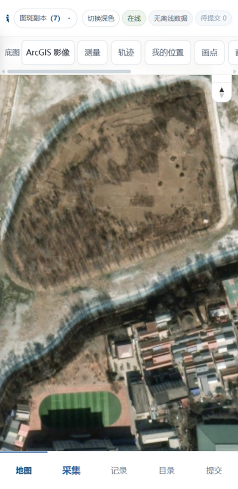

# 调研手记 · 规划调研智能工作台

面向村庄规划现场调研的一体化工作台：**一张图上完成底图核对、图斑录入、现状调查、规划诉求记录与成果输出**，为规划师外业调研量身打造。

> **产品展示页（在线看）**：<https://liulei97.github.io/diaoyan-shouji/>
>
> 本仓库为产品展示页，源码暂未开放。欢迎交流调研方法与产品思路；未经授权，请勿复制、商用或二次分发本项目的任何界面素材与文档内容。

## 它解决什么问题

村庄规划调研常年面对"纸图 + 相机 + Excel"的碎片化流程：现场勾图靠手绘、记录靠纸笔、回办公室再数字化。调研手记把这条链路搬进一块屏幕——**在现场就把图斑、记录、照片、诉求全部数字化**，回到办公室直接出成果。

## 核心能力

- **在线底图 + 多源数据叠加**：ArcGIS 影像/天地图底图，支持上传 SHP、File GDB、CAD（DWG/DXF）成果图层，坐标系自动识别（含 CGCS2000 各带、随图 .prj）。
- **图斑副本（调查对象）**：点选或勾选录入图斑，自动按地块类型编号建档；顶点编辑、分割/合并/打断/延伸、简化/外扩/内缩一应俱全，转性地块可重新编号。
- **现状调查动态表单**：按地块类型下发专项字段（宅基地/耕地/商工仓储…），支持自定义字段；多人协作带录入人归属与版本留痕。
- **图斑档案一键预览**：点选图斑弹出档案浮窗——基本信息、全部调研内容明细、挂接的规划诉求，一窗阅览。
- **规划诉求管理**：诉求可挂原图斑/图斑副本/设施图戳/自绘范围，支持编辑与删除，地图橙色虚线直观呈现。
- **设施图戳**：16 大类现状/规划两套标准图戳，点图即录入调查，自动联动地块类型与规划诉求。
- **离线优先采集**：现场断网照常采集，数据存本机，联网自动入库；手机/平板端有专属交互（底部导航、抽屉表单、触屏增强）。
- **多用户与权限**：个人/团体项目、账号体系、行级数据归属、共享编辑开关。
- **成果输出**：调研图带图戳导出、Excel 台账、SHP/DXF 成果回传。

## 近期更新（v1.16 – v1.25）

- **台账能力批（v1.16）**：台账改左右式问答卡（字段名在左、填写在右），行字段可各自指定标点/标线/不标；一行可标多处要素；模板扩展合计栏、自定义候选清单（单选多选共用）、地类-地段级联与多选。
- **设计器八项增强 + 手机端外业（v1.17）**：条件显示升级为且/或分组与多算子；台账行列可调序；单选多选支持「其他」自填；问卷一键转单文件静态网页；手机端采集页——四类清单拍照、轨迹记录、GPS 定位 + 地图点选修正、离线队列自动补传。
- **现场问卷与村情版本（v1.18）**：项目负责人可在项目内自建填报任务，边填边画图斑，提交即自动核实并入；村情字段可版本管理与回滚；选项与图戳一一对应；并入前给跨村混放提示与 409 一键出口。
- **底座工程（v1.19）**：数据访问收口进六域仓储、附件存储抽象、时间与 JSON 单点；新增 8 步真登录 UI 冒烟；切项目启用概览去重（体积 -31%）与 ETag/304。
- **来源村溯源 + 台账明细（v1.20）**：设施/图斑/诉求/清单四类行记来源村，地图胶囊可按村筛选，Excel 各成果表补列；报送 Excel 增台账明细长表；台账题放开数量上限。
- **线状设施上图（v1.21）**：线行并入默认落设施台账（按项目坐标系量算长度），地图线图层渲染、点选弹档案；成果补设施清单与诉求两列。
- **村界多套 + 区镇筛选（v1.22）**：村界集合支持全局/项目两档，同名村靠区镇区分；下发与核实队列按区/镇/村三级筛选，CSV 补录区镇。
- **统计下沉（v1.23）**：项目统计改在 SQL 里聚合（含子项目与可见性），胶囊/六格/看板直接读统计接口。
- **按项目分库（v1.24）**：meta 管账号/共享村界/全局模板，每个项目独立 sqlite；备份、校验、恢复、归档导出、借出回灌两种布局全接通（单库模式行为不变）。
- **定义查询与侧栏（v1.24.1）**：图例标题行直达定义查询弹窗（字段与取值自动列出，地图层与预览层同口径）；左侧栏改「数据 / 图层」页签可整栏收起；本机样式覆盖改合并写入。
- **结构拆分（v1.25）**：187 条接口按域归位、报送并入链独立成服务、前端拆 6 个 composable——行为零变化，全量 1364 项自动化测试与 8 步 UI 冒烟守着。

## 界面速览

| | |
|---|---|
|  |  |
|  |  |

## 技术形态

单机/内网部署（Windows 一键启动），另有免安装桌面版。Vue 3 + MapLibre GL + FastAPI + SQLite，支持局域网多端访问与 HTTPS；调查数据本机优先，照片与轨迹不出网。

## 版权与使用

© 2026 保留所有权利。本项目源码与设计版权归作者所有：**仅供学习交流参考，未经授权不得复制、修改、商用或二次分发**。如需试用、合作或定制，欢迎提 Issue 或与作者联系。
